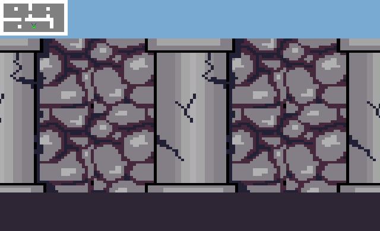

# cub3D

Un raycaster façon *Wolfenstein 3D* écrit en C avec la MiniLibX, réalisé dans le cadre du cursus 42.

<p align="center">
  
</p>

## Fonctionnalités

- Raycasting avec l'algorithme DDA
- Une texture différente par orientation de mur (N / S / E / O)
- Couleurs du sol et du plafond configurables
- Collisions avec les murs
- Parsing des fichiers `.cub` avec gestion d'erreurs (map non fermée, caractère invalide, texture manquante, couleur invalide…)

**Bonus**

- Minimap avec la position et la direction du joueur
- Portes qui s'ouvrent et se ferment (`E`)
- Rotation de la caméra à la souris

## Compilation

Dépendances (Linux) : `cc`, `make`, `libX11`, `libXext`.

```sh
make        # version mandatory
make bonus  # version bonus (minimap, portes, souris)
```

## Utilisation

```sh
./cub3D map/test/map.cub
```

| Touche        | Action                   |
| ------------- | ------------------------ |
| `W` `A` `S` `D` | Se déplacer            |
| `←` `→`       | Tourner la caméra        |
| Souris        | Tourner la caméra (bonus) |
| `E`           | Ouvrir / fermer une porte (bonus) |
| `Échap`       | Quitter                  |

## Format de map

```
NO ./includes/texture/colonne.xpm
SO ./includes/texture/anarchy.xpm
WE ./includes/texture/windoz.xpm
EA ./includes/texture/monster.xpm
DO ./includes/texture/door.xpm

F 46,38,52
C 120,170,210

1111111111111111111
1000000010000000001
1000100010000100001
1000000D00000000001
1000000010000100001
111111D111111110001
1000000000000010001
100001000N000010001
1000000000000000001
1111111111111111111
```

| Élément            | Signification                                   |
| ------------------ | ----------------------------------------------- |
| `NO` `SO` `WE` `EA` | Texture `.xpm` de chaque face de mur           |
| `DO`               | Texture des portes (bonus)                      |
| `F` / `C`          | Couleur RGB du sol / du plafond                 |
| `1` / `0`          | Mur / sol                                       |
| `N` `S` `E` `W`    | Position de départ et orientation du joueur     |
| `D`                | Porte (bonus)                                   |

La map doit être entièrement fermée par des murs. Cet exemple est `map/test/demo.cub` (la map du GIF). Des maps de test sont dans `map/test/`, et des maps volontairement invalides dans `map/error/`.

## Structure

```
srcs/            version mandatory
  parsing/       lecture et validation du fichier .cub
  graphics/      raycasting, DDA, rendu des murs
  mlx_stuff/     fenêtre, textures, hooks clavier
srcs_bonus/      version bonus (+ minimap, portes, souris)
includes/        headers, libft, minilibx, textures
map/             maps de test et maps d'erreur
```
